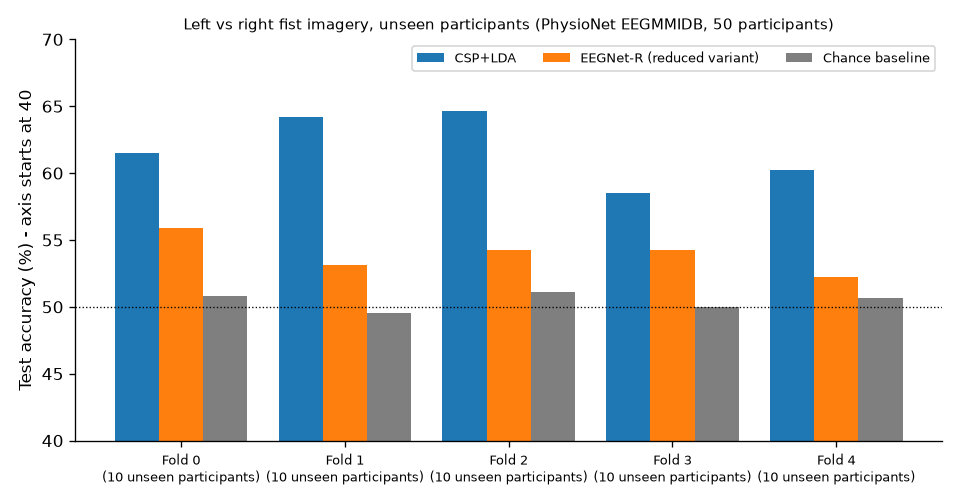

# brain-signals-lab

Can a simple, classical EEG pipeline tell **imagined left-fist from imagined right-fist
movement** in people it has never seen before? This is a small, CPU-only engineering project
that answers that for one public dataset. The protocol was fixed before any modelling, every
fold and every test participant is reported, and the results sit next to explicit chance
references.

> **Scope.** These are engineering results for one pipeline on one subset of one public dataset.
> They are not findings about the brain or about motor imagery in general (see [Limits](#limits)).

## Problem

- **Input:** 64-channel scalp EEG, 160 Hz, cut into 3-second trials (0.5–3.5 s after a visual cue).
- **Output:** left vs right fist imagery. The two classes are balanced (1132 vs 1113 trials).
- **The hard part:** generalising **across people**. Training and test participants never
  overlap: in each of 5 frozen outer folds, 40 participants are used for training and 10
  unseen participants are scored.

## Data

PhysioNet **EEG Motor Movement/Imagery Dataset v1.0.0** (Schalk, 2009,
[doi:10.13026/C28G6P](https://doi.org/10.13026/C28G6P)), licensed **ODC-By 1.0**. This project uses
participants S001–S050 and runs 4, 8 and 12 (imagined left/right fist): 150 recordings and
2245 usable trials. The subset was fixed before download. The data is **not
redistributed** here; `scripts/fetch_data.py` downloads it and checks each file against
PhysioNet's SHA-256 list. The inventory and sanity checks are in [DATA.md](DATA.md) and
[reports/sanity_summary.md](reports/sanity_summary.md).

## Method

The protocol was committed before any modelling code: [docs/evaluation_protocol.md](docs/evaluation_protocol.md).

1. **Participant split:** 5 outer folds of 10 participants (seeded; [splits/FROZEN_participant_folds.json](splits/FROZEN_participant_folds.json)).
2. **Pipeline:** band-pass filter → common spatial patterns (CSP, log-variance features) → linear discriminant analysis (LDA).
3. **Fitted on training participants only, in every fold:**
   - the band ({8–13, 13–30, 8–30} Hz) and the number of CSP components ({4, 6}), chosen by an inner cross-validation grouped by participant;
   - trial rejection (peak-to-peak above Q3 + 3·IQR, training trials only);
   - the CSP filters and the LDA weights.

   Test trials are never rejected or used for tuning.
4. **Chance references:**
   - a most-frequent-class baseline;
   - for each fold, a 100× label-permutation test that refits the pipeline;
   - for each participant, an exact binomial test with a 95% Clopper–Pearson interval and Holm correction.

## Results (unseen participants)

| Outer fold | Chosen on training (band, CSP) | Test trials | CSP+LDA | Chance baseline | Permutation null mean / 95th pct | Permutation p |
|---|---|---|---|---|---|---|
| 0 | 13–30 Hz, 4 | 449 | **61.5%** | 50.8% | 50.0% / 51.9% | 0.0099 |
| 1 | 13–30 Hz, 4 | 450 | **64.2%** | 49.6% | 50.0% / 52.9% | 0.0099 |
| 2 | 8–13 Hz, 4 | 450 | **64.7%** | 51.1% | 50.1% / 53.3% | 0.0099 |
| 3 | 8–13 Hz, 4 | 448 | **58.5%** | 50.0% | 50.1% / 52.5% | 0.0099 |
| 4 | 8–30 Hz, 6 | 448 | **60.3%** | 50.7% | 50.4% / 54.3% | 0.0099 |
| **Mean ± SD** | | 2245 | **61.8% ± 2.6%** | 50.4% ± 0.6% | | |

- **Chance reference:** 50%. Every fold is above all 100 of its permuted-label refits. p = 1/101
  ≈ 0.0099 is the smallest p-value this test can give, so it means "above every permutation",
  not "p = 0.01 exactly".
- **Per participant (n = 50):** median 57.8%, range 44.4%–97.8%.
  20 participants are above chance at p < 0.05 (uncorrected),
  and 7 remain after Holm correction. With about 45 trials, a participant
  needs about 29 correct (64%) to count as above chance, so most individual results cannot be
  told apart from guessing.
  The full table is in [reports/evaluation_summary.md](reports/evaluation_summary.md).
- **Neural network (reduced variant, "EEGNet-R"): 53.9% ± 1.4%, below CSP+LDA.**
  The original EEGNet protocol was timed (one fit took 167 CPU-seconds, projecting about 45
  CPU-minutes) and **never run**. Instead, a cheaper variant was pre-registered (dropout 0.25,
  at most 15 epochs, epoch count chosen on validation participants), re-timed (14.3 CPU-minutes
  projected) and run once (11.2 CPU-minutes) on the same frozen folds.
  It is lower than CSP+LDA in every fold (by 4–11 points). Per participant, the median is
  54.4%; 4 participants are above chance
  uncorrected and 0 after Holm. Paired with CSP+LDA, CSP+LDA is
  better for 33 of 50 participants (exploratory Wilcoxon p ≈ 2e-04).
  This is a result about **this reduced, briefly trained configuration**, not about EEGNet or
  neural networks in general. Details and per-participant table:
  [reports/eegnet_reduced_summary.md](reports/eegnet_reduced_summary.md).

  | Fold | CSP+LDA | EEGNet-R (reduced) | Chance baseline |
  |---|---|---|---|
  | 0 | 61.5% | 55.9% | 50.8% |
  | 1 | 64.2% | 53.1% | 49.6% |
  | 2 | 64.7% | 54.2% | 51.1% |
  | 3 | 58.5% | 54.2% | 50.0% |
  | 4 | 60.3% | 52.2% | 50.7% |
  | Mean ± SD | 61.8% ± 2.6% | 53.9% ± 1.4% | 50.4% |

### Chart



Per-fold test accuracy on unseen participants, drawn by `scripts/plot_results.py` from `reports/eegnet_reduced.json`.
Note that the axis starts at 40%.

## Limits

**What the results do show (engineering):** under this frozen protocol, this CSP+LDA
pipeline beats chance on average when it is applied to new people. The fold-to-fold spread
is about ±3 points, and performance varies a lot between individuals.

**What they do not show (domain):**
- Nothing about the neural mechanisms of motor imagery. The CSP patterns were not
  analysed or interpreted.
- Nothing about whether a participant "can" or "cannot" do motor imagery. A low score may
  come from noise, artefacts, the fixed time window or the model itself.
- No state-of-the-art or comparative claim. Other work on this dataset uses different
  participants, runs, windows and protocols, and was not reproduced here.
- No clinical, assistive-technology or real-time claim. Everything here is offline
  classification of cue-locked trials.

**Methodological limits:**
- 50 of 109 participants and 3 runs each. One dataset, one recording system.
- Only 5 folds, so the SD is a rough measure of spread. The inner grid scores are close
  together (about 58–65%), so the configuration choice matters little.
- The amplitudes are high and 60 Hz mains noise is common
  ([reports/sanity_summary.md](reports/sanity_summary.md)). Test trials are scored without any
  cleaning.
- The CSP is a covariance-based implementation, not MNE's default (see the deviation log).
- The first evaluation attempt went over its compute budget and was stopped before any
  result was seen. The evaluation ran to completion exactly once.
- The neural comparison is a reduced variant: one seed per fold, no dropout search, and at
  most 15 epochs (fold 0 picked the maximum). Its per-fold chance test (a pooled binomial) is
  weaker than the permutation test used for CSP+LDA.

## Reproduce (CPU only)

```
python -m venv .venv && .venv/bin/pip install -r requirements.txt
.venv/bin/python scripts/fetch_data.py      # 150 EDF files, 384,539,520 bytes, checksum-verified
.venv/bin/python scripts/inventory.py       # -> reports/data_inventory.json
.venv/bin/python scripts/sanity_checks.py   # -> reports/sanity_report.json, reports/sanity_summary.md
.venv/bin/python scripts/evaluate.py        # -> reports/evaluation.json (about 2.5 CPU-min with 2 threads)
.venv/bin/python scripts/summarize.py       # -> reports/evaluation_summary.md
.venv/bin/python -m pytest -q
# optional reduced EEGNet run (needs a CPU build of torch; not in requirements.txt; about 11 CPU-min):
python scripts/prepare_nn_inputs.py && python scripts/eval_eegnet.py --run reduced && python scripts/summarize_eegnet.py
```

`scripts/make_splits.py` only confirms the frozen split; it refuses to produce a different one.

## Licence and attribution

- **Code:** MIT ([LICENSE](LICENSE)), © 2026 Erfan Pirjahandideh.
- **Data:** not included. The EEG Motor Movement/Imagery Dataset is © its contributors and
  licensed under the [Open Data Commons Attribution License v1.0](https://opendatacommons.org/licenses/by/1-0/).
  If you use it, cite: Schalk, G. (2009). *EEG Motor Movement/Imagery Dataset* (v1.0.0).
  PhysioNet. https://doi.org/10.13026/C28G6P, and PhysioNet as described in [DATA.md](DATA.md).
- The derived files in `reports/` (summary statistics and accuracies) are results computed from
  that dataset, shared with the attribution above.

## How this was made

Erfan Pirjahandideh wrote this code with AI assistance (Grok Bot). Every reported number comes
from the scripts and JSON reports in this repository and was checked against them.
